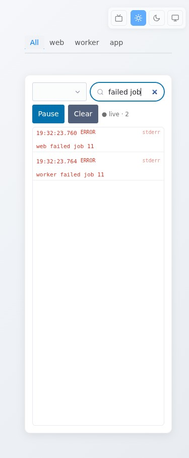

# Log Viewer

A live log viewer built with [tinkerdown](https://github.com/livetemplate/tinkerdown). It follows commands, docker containers and log files, and shows them in one timeline with a tab per source, level and text filters, pause, and clear.


## Run it

```sh
tinkerdown serve --allow-exec .
```

Then open http://localhost:8080. The default sources are two demo processes (`web` and `worker`) and the file `logs/app.log`, so the page shows lines straight away. `--allow-exec` lets sources run commands. Without it, only file sources work.

Stream sources need tinkerdown with stream support: tinkerdown built from `main` until the next release.

## Add your own logs

Sources live in the frontmatter of `index.md`. Each `stream` source follows one command or one file:

```yaml
sources:
  api:
    type: stream
    cmd: docker logs -f --timestamps --tail 200 api
  syslog:
    type: stream
    file: /var/log/syslog
```

Then add the new names in two places in `index.md`:

1. `inputs` of the `all` source, so they join the timeline.
2. The tabs heading, for example `| [api] source = api`.

The frontmatter has commented examples for docker, journald and kubectl. All stream options are in [tinkerdown's stream source docs](https://github.com/livetemplate/tinkerdown/blob/main/docs/sources/stream.md).

## Use it

| To | Do |
|----|----|
| Watch everything | Stay on **All**. The list follows new lines. |
| Read back | Scroll up. The list stops following until you scroll back to the bottom. |
| Focus on one source | Pick its tab. |
| Find errors | Set the level to **error**. It keeps applying when you switch tabs. |
| Find text | Type in the search box. |
| Freeze the view | **Pause**. **Resume** catches up. |
| Start fresh | **Clear** hides the lines shown so far. |

Lines from stderr and the viewer's own notes (such as a restarted command) are marked at the right of each line.

On a phone, each line puts its time and level above the message:



## Test

The end-to-end test in `e2e/` builds tinkerdown from source, serves a copy of this app, and drives it in Chrome. It needs Docker and Go.

```sh
cd e2e && go test ./...
```

The test has its own Go module, so the app itself is only `index.md` and its demo files. `TINKERDOWN_SRC` points at the tinkerdown checkout to build. It defaults to `../../tinkerdown`, a sibling of this repo, and a relative path is read from `e2e/`. The build uses that checkout's committed client bundle, so run `make build-client` there after changing its client. To test a binary you already built, set `TINKERDOWN_BIN` instead.
