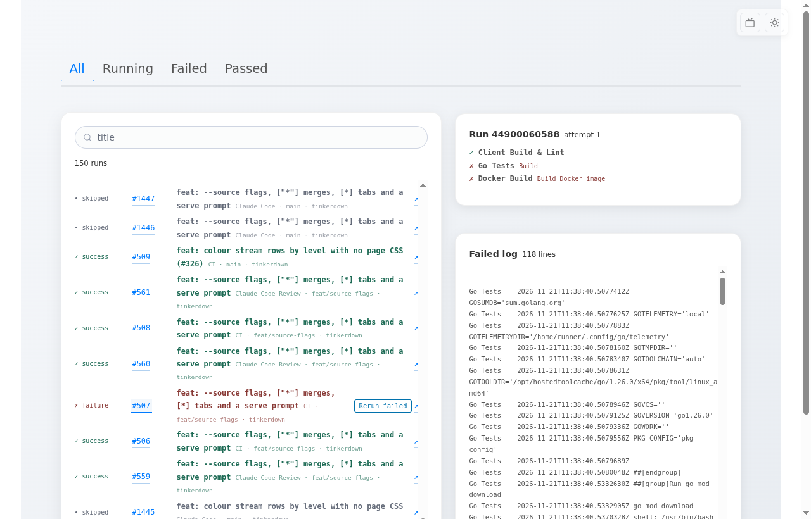
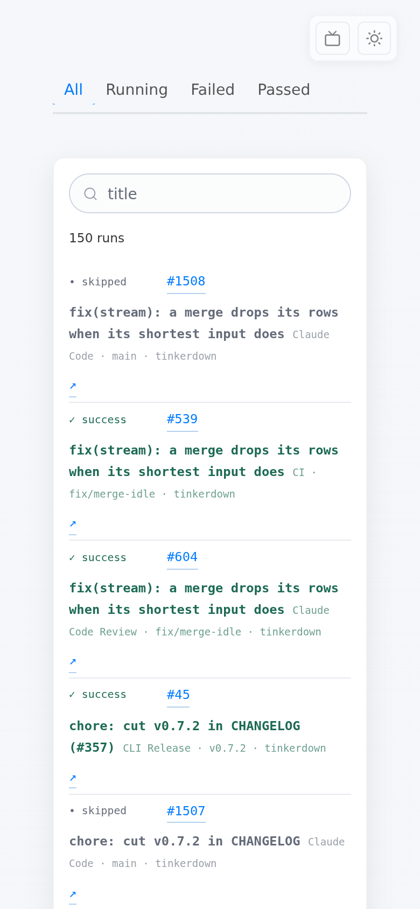

# CI

Shows your GitHub Actions runs as a live list, newest first. Click a run's number to watch its jobs finish, and if it fails, to read the failing job's log beside the list. Rerun the failed jobs, or cancel a run, from its row.



## Run it

You need the [GitHub CLI](https://cli.github.com), signed in (`gh auth login`). The page runs no command of its own: you pass the `gh` commands it uses as flags. Replace `OWNER/REPO` with your repo:

```sh
tinkerdown serve --allow-exec github.com/livetemplate/onefile/ci \
  --source 'myapp=while :; do if out=$(gh run list --repo OWNER/REPO --limit 30 --json databaseId,number,status,conclusion,workflowName,displayTitle,headBranch,event,createdAt,updatedAt,url,attempt --jq ".[] | .id = (.databaseId | tostring) | .ref = \"\(.databaseId)-\(.attempt)\" | .repo = (.url | split(\"/\")[3:5] | join(\"/\"))" 2>&1); then printf "%s\n" "$out" "{\"cleared\":true}"; else printf "%s\n" "$out" | paste -sd " " - >&2; fi; sleep 15; done' \
  --source 'jobs=while :; do out=$(gh run view "$TD_run" --repo "$TD_repo" --attempt "$TD_attempt" --json status,jobs --jq "(.jobs[] | {name, status, conclusion, failed: ([.steps[] | select(.conclusion == \"failure\") | .name] | join(\", \"))}), (select(.status == \"completed\") | {done: true})" 2>&1) || { printf "%s\n" "$out" | paste -sd " " - >&2; sleep 10; continue; }; printf "%s\n" "$out"; case "$out" in *\"done\":true*) exec tail -f /dev/null;; esac; sleep 10; done' \
  --source 'log=until s=$(gh run view "$TD_run" --repo "$TD_repo" --attempt "$TD_attempt" --json status,conclusion --jq ".status + \" \" + .conclusion") && [ "${s%% *}" = completed ]; do sleep 30; done; [ "${s#* }" = success ] || { out=$(gh run view "$TD_run" --repo "$TD_repo" --attempt "$TD_attempt" --log-failed | cut -f1,3- | awk "{ gsub(/\033\[[0-9;]*m/, \"\"); print }"); [ -z "$out" ] || { printf "%s\n" "$out" | grep -B 30 "##\[error\]" | grep -v "^--$" || printf "%s\n" "$out" | tail -n 200; }; }; exec tail -f /dev/null' \
  --action 'rerun=case "$TD_run" in ""|*[!0-9]*) echo "not a run ID" >&2; exit 1;; esac; case "$TD_repo" in */*/*|.*|*/.*|*[!A-Za-z0-9_./-]*) echo "not a repo" >&2; exit 1;; ?*/?*) ;; *) echo "not a repo" >&2; exit 1;; esac; gh run rerun "$TD_run" --failed --repo "$TD_repo"' \
  --action 'cancel=case "$TD_run" in ""|*[!0-9]*) echo "not a run ID" >&2; exit 1;; esac; case "$TD_repo" in */*/*|.*|*/.*|*[!A-Za-z0-9_./-]*) echo "not a repo" >&2; exit 1;; ?*/?*) ;; *) echo "not a repo" >&2; exit 1;; esac; gh run cancel "$TD_run" --repo "$TD_repo"'
```

Then open http://localhost:8080. It needs tinkerdown 0.9.1 or later.

Each flag does one job:

| Flag | What it does |
|------|--------------|
| `--source myapp=…` | Lists the repo's latest 30 runs every 15 seconds. When `gh` fails, for example on a rate limit, its message shows at the top until the next poll works. |
| `--source jobs=…` | For the run you clicked, lists its jobs every 10 seconds until the run completes, with each job's failed steps. |
| `--source log=…` | Once the run completes without passing, shows each error in its failed jobs' logs, with the 30 lines before it. |
| `--action rerun=…` | Reruns the run's failed jobs. |
| `--action cancel=…` | Cancels the run, after asking. |

Each command gets the run's ID, repo and attempt as `$TD_run`, `$TD_repo` and `$TD_attempt`, environment variables, so a value is never read as shell code. The actions also check the run is a number and the repo is `owner/name` before calling `gh`. The commands are yours, from your flags; the page only names them.

**Several repos:** repeat the first `--source` with another name and repo, such as `--source 'web=… --repo OWNER/web …'`. Each name shows under its runs.

**Requests:** each repo's list costs 240 GitHub API requests an hour, and a run you have open adds about 480 while it runs: its jobs every 10 seconds, its status every 30. GitHub allows 5,000 an hour, so for many repos, raise the `sleep 15`. The list keeps 200 runs; for more than six repos, that holds fewer than 30 each.

A failed log can show secrets that a job printed by mistake, so share the page with care.

## Use it

| To | Do |
|----|----|
| Wait for a run | Watch its row: ● running turns ✓ success or ✗ failure. |
| Watch its jobs | Click its number. The pane lists its jobs as they finish. |
| Read why it failed | Below the jobs, each error with the lines before it. |
| Rerun what failed | Press **Rerun failed** on its row. |
| Stop a run | Press **Cancel**. It asks first. |
| Find a run | Pick **Running**, **Failed** or **Passed**, or search by title. |
| Open it on GitHub | Press ↗ on its row. |

A rerun keeps the run's number with the next attempt, so an open pane on the old attempt empties; click the number again for the new one.

On a phone, each row puts the title under the state, and the jobs and log sit below the list:



## Test

`TestCI` in [`../e2e`](../e2e) runs the command above through bash, with a fake `gh` that answers from fixture files and never calls GitHub, and drives the page in Chrome:

```sh
cd ../e2e && go test -run TestCI ./...
```

It needs `jq`, which the fake `gh` uses to apply the commands' `--jq` expressions.
