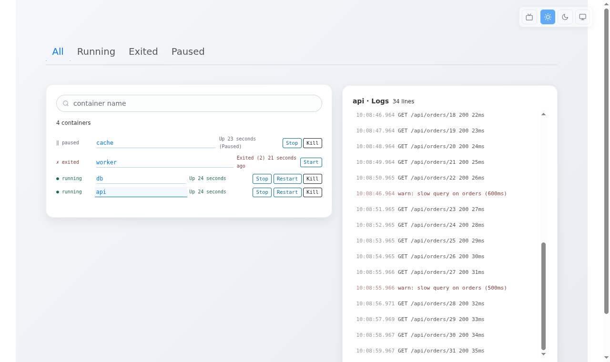
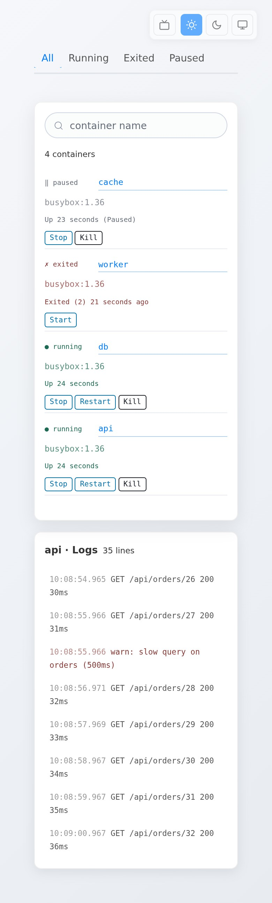

# Containers

Lists your Docker containers live, with buttons to start, stop, restart and kill them. Click a container's name to follow its logs in the pane beside the list.



## Run it

The page runs no command of its own. You pass the Docker commands it uses as flags:

```sh
tinkerdown serve --allow-exec https://raw.githubusercontent.com/livetemplate/onefile/main/containers/index.md \
  --source 'docker=docker ps -a --format "{\"name\":{{json .Names}},\"image\":{{json .Image}},\"state\":{{json .State}},\"status\":{{json .Status}}}"; exec docker events --filter type=container --filter event=create --filter event=start --filter event=die --filter event=pause --filter event=unpause --filter event=destroy --format "{\"name\":{{json .Actor.Attributes.name}},\"image\":{{json .Actor.Attributes.image}},\"state\":\"{{if eq .Action \"start\" \"unpause\"}}running{{else if eq .Action \"die\"}}exited{{else if eq .Action \"pause\"}}paused{{else if eq .Action \"destroy\"}}removed{{else}}created{{end}}\",\"status\":\"{{if eq .Action \"start\" \"unpause\"}}running{{else if eq .Action \"die\"}}exited ({{index .Actor.Attributes \"exitCode\"}}){{else if eq .Action \"pause\"}}paused{{else if eq .Action \"destroy\"}}removed{{else}}created{{end}}\"}"' \
  --source 'logs=docker events --filter container="$TD_name" --filter event=start --filter event=destroy --format "{{.Action}}" | { run=$(docker inspect -f "{{.State.StartedAt}}" -- "$TD_name"); docker logs -f --timestamps --tail 200 -- "$TD_name"; while read -r event && [ "$event" = start ]; do now=$(docker inspect -f "{{.State.StartedAt}}" -- "$TD_name"); [ "$now" = "$run" ] || { run=$now; docker logs -f --timestamps --since "$now" -- "$TD_name"; }; done; }' \
  --action 'start=docker start -- "$TD_name"' \
  --action 'stop=docker stop -- "$TD_name"' \
  --action 'restart=docker restart -- "$TD_name"' \
  --action 'kill=docker kill -- "$TD_name"'
```

Then open http://localhost:8080. It needs tinkerdown 0.7.1 or later.

Each flag does one job:

| Flag | What it does |
|------|--------------|
| `--source docker=…` | Prints every container with `docker ps`, then follows `docker events` for changes. Both print the same JSON line: name, image, state and status. |
| `--source logs=…` | Follows the logs of the container you clicked. It watches `docker events` for the container's restarts and follows each new run from its start, so no line shows twice. |
| `--action start=…` and the others | Run when you press a row's button. Leave one out and its button still shows, but pressing it runs nothing. |

Each command gets the container's name as `$TD_name`, an environment variable, so a name is never read as shell code. Keep the quotes around it, `"$TD_name"`, so a name stays one argument.

To list fewer containers, add a filter to both `docker ps` and `docker events`, such as `--filter label=com.docker.compose.project=myapp`.

## Use it

| To | Do |
|----|----|
| See what's running | Pick **Running**, or search by name. |
| Notice a crash | An exited container turns red and shows its exit code: `exited (137)`. |
| Read a container's logs | Click its name, and the pane beside the list shows its logs under its name. It follows new lines; scroll up to stop following, and back down to resume. |
| Stop, start or restart one | Press the button on its row. A row shows only the buttons its state allows, and a pressed button spins until Docker is done. |
| Kill one | Press **Kill**. It asks first. |

A removed container leaves the list. Links to a container's logs, such as `?name=web`, work only while that container is in the list, so a link from elsewhere can't start logs for a name you don't have.

On a phone, each row puts the image and status under the name, and the logs sit below the list:



## Test

`TestContainers` in [`../e2e`](../e2e) runs the command above through bash, narrowed to containers it starts with a test label, and drives the page in Chrome:

```sh
cd ../e2e && go test -run TestContainers ./...
```
