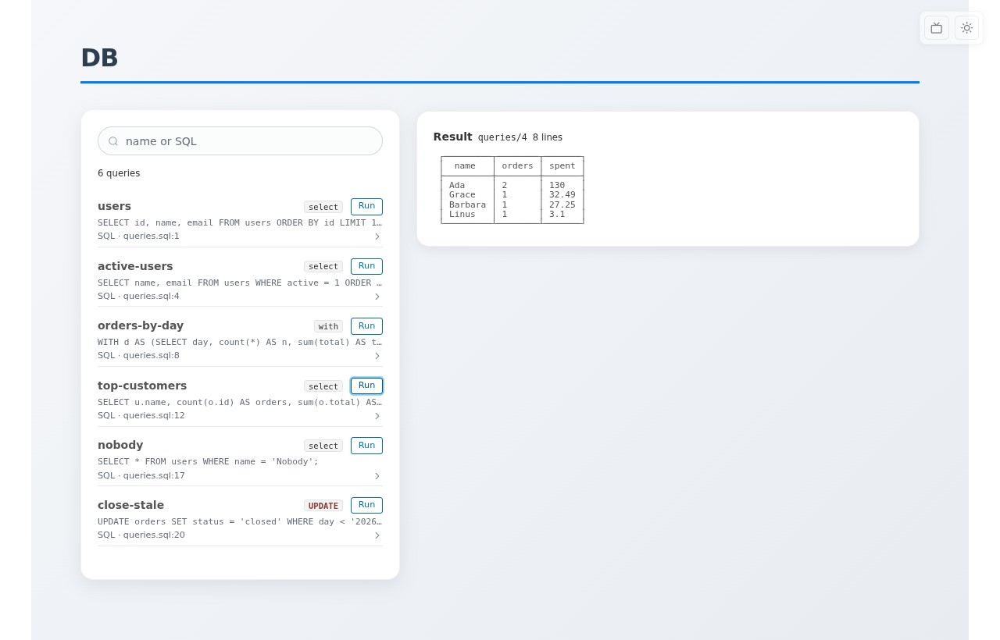
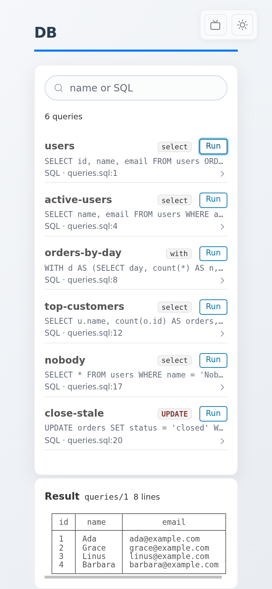

# DB

Lists the queries in your `.sql` files, each with a Run button, and shows the result as your database's command-line client prints it. Editing a file updates the list. It works with SQLite and Postgres, through the `sqlite3` and `psql` you already have.



## Run it

The page holds no queries and runs no command of its own. You pass your `.sql` file and the command that runs a query.

SQLite:

```sh
tinkerdown serve --allow-exec github.com/livetemplate/onefile/db \
  --source sql:./queries.sql \
  --source 'run=sqlite3 -safe -readonly -box ./app.db " $TD_sql"'
```

Postgres, with the connection from `PGHOST`, `PGDATABASE`, `~/.pgpass` and the like:

```sh
tinkerdown serve --allow-exec github.com/livetemplate/onefile/db \
  --source sql:./queries.sql \
  --source 'run=PGOPTIONS="-c default_transaction_read_only=on -c statement_timeout=30s" psql -X -v ON_ERROR_STOP=1 -c " $TD_sql"'
```

Then open http://localhost:8080. It needs tinkerdown 0.10.0 or later, and sqlite3 3.37 or later for `-safe`. The `sqlite3` macOS ships is new enough.

| Flag | What it does |
|------|--------------|
| `--source sql:./queries.sql` | Reads your `.sql` file, one row per query, and reads it again when it changes. A folder, such as `sql:./queries/`, gives the queries of each `.sql` file in it. A relative path is taken from the directory you run `serve` in. Pass one per file or folder. |
| `--source run=…` | Runs the query you clicked. The page's Run button runs the source named `run`, so this one keeps its name. It gets the query's SQL as `$TD_sql`. |

Both commands are read-only: `-readonly` for sqlite3, and `default_transaction_read_only` for psql. A query that writes fails with the database's error and changes nothing. To let the page write, change the command.

The space in `" $TD_sql"` matters. Without it, sqlite3 reads a query that starts with a `--` comment as an option, and fails. psql would run a query that starts with a backslash, such as `\! rm -rf ~`, as its own command instead of sending it to the server.

## Write the .sql file

A query starts at a `-- name:` line and runs to the next one. sqlc, aiosql, yesql and HugSQL write their files this way, so the same file keeps working with them:

```sql
-- name: users
SELECT id, name, email FROM users LIMIT 100;

-- name: close-stale
UPDATE orders SET status = 'closed' WHERE day < '2026-11-25';
```

- The name is the first word after `-- name:`, or HugSQL's `-- :name`. A word after it, such as sqlc's `:one`, is left out.
- A file with no `-- name:` line is one query, named after the file: `users.sql` is `users`.
- Text before the first `-- name:` line is skipped.

Parameters such as `$1`, `:id` or `@name` have no values here, so a query that uses them fails with the database's error.

## Use it

| To | Do |
|----|----|
| Run a query | Press **Run** on its row. The result pane names the query's entry, such as `queries/1`, shows "● running", then the client's table. A wide table scrolls sideways inside the pane. |
| See an empty result | With sqlite3, a query that returns no rows says "No rows". psql prints the column names and `(0 rows)`. |
| See why a query failed | The client's error shows in red, tagged `stderr`, with its exit status, such as `process exit status 8`. |
| Spot a query that writes | Its first keyword, such as `UPDATE` or `DELETE`, is red and in capitals. |
| Read a query's SQL | Its first line shows under its name. Open **SQL** under the row for the whole query, with its file and line. |
| Find a query | Search by name or SQL. |
| Browse a table | Add a query such as `SELECT * FROM users LIMIT 100` to the file. |

Only a press on Run runs a query. Reloading the page, going Back or opening a shared link runs nothing.

psql 13 and 14 print only the last statement's result when a query holds several. psql 15 and later print each.

On a phone, the result pane sits below the list and sticks to the bottom of the screen, so a Run shows its result without scrolling:



## What the page can show

- **Results.** A result can show any data the connection can read.
- **Queries.** The page shows each query's SQL, so a secret written into a `.sql` file shows too.
- **Not the password.** The password never reaches the page: psql reads it from `~/.pgpass` or `PGPASSWORD`, and it isn't on the command line, where `ps` would show it.

A `.sql` file runs as you, so pass only files you'd run in your terminal. Read-only guards against mistakes, not against a query written to get past it: Postgres lets a query run `SET default_transaction_read_only = off`. For a hard limit, connect as a role that can only read.

## Test

`TestDB` in [`../e2e`](../e2e) runs the SQLite command above through `sh`, with a stand-in `sqlite3` that prints real sqlite3 output, and drives the page in Chrome:

```sh
cd ../e2e && go test -run TestDB ./...
```
