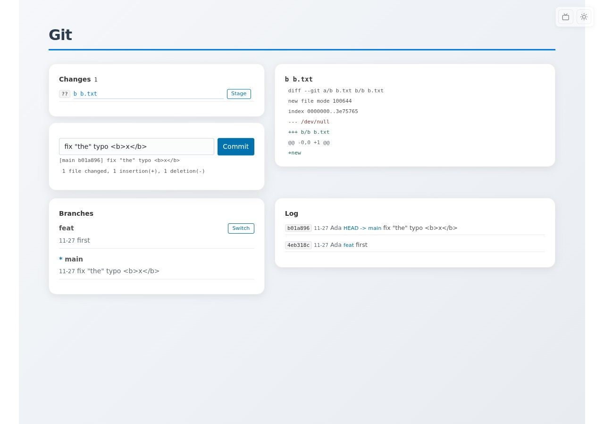
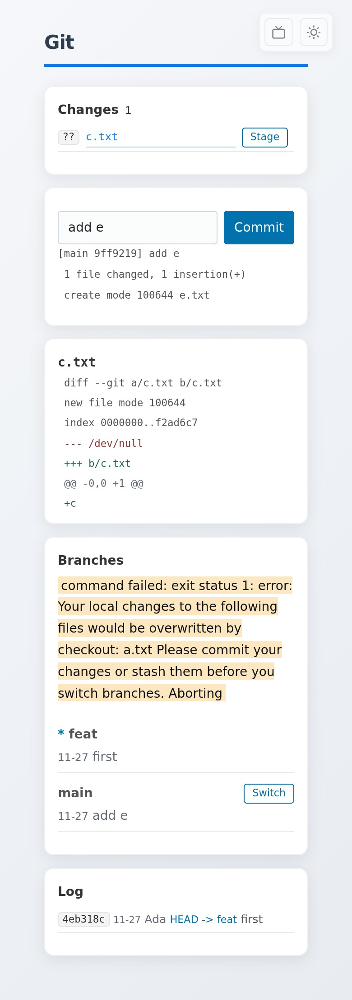

# Git

Shows your repo's changed files, branches and log, and keeps them current. Buttons stage and unstage a file, switch branch, and commit with a message you type. Clicking a file shows its diff. It covers the everyday loop, not every git command, and runs the `git` you already have.



## Run it

Run this in your repo. The page holds no commands: each one below is yours, and runs in the directory you run `serve` in.

```sh
GIT_LITERAL_PATHSPECS=1 GIT_OPTIONAL_LOCKS=0 tinkerdown serve --allow-exec github.com/livetemplate/onefile/git \
  --source 'status=git status -z --no-renames --untracked-files=all | tr "\000" "\n"' \
  --source 'branches=git for-each-ref --format="%(HEAD)%09%(refname:short)%09%(upstream:track,nobracket)%09%(committerdate:format:%m-%d)%09%(contents:subject)" refs/heads' \
  --source 'log=git log -n 100 --date=format:%m-%d --format="%H%x09%h%x09%cd%x09%an%x09%D%x09%s"' \
  --source 'diff=if [ -n "$(git ls-files -o --exclude-standard -- "$TD_path")" ]; then git diff --no-index -- /dev/null "$TD_path"; [ $? -le 1 ]; else git diff --cached -- "$TD_path"; git diff -- "$TD_path"; fi' \
  --source 'commit=env -u GIT_LITERAL_PATHSPECS git commit -m "$TD_message"' \
  --action 'stage=git add -- "$TD_path"' \
  --action 'unstage=git reset -q -- "$TD_path"' \
  --action 'switch=git switch -- "$TD_branch"'
```

Then open http://localhost:8080. It needs tinkerdown 0.11.0 or later and git 2.23 or later, for `git switch`.

| Flag | What it does |
|------|--------------|
| `GIT_LITERAL_PATHSPECS=1` | Makes every git command take a path as written. Without it, a path such as `:/` or `*` would stage the whole repo. |
| `GIT_OPTIONAL_LOCKS=0` | Keeps the page's reads from writing `.git/index`, so they never make your own `git commit` fail on `index.lock`. |
| `--source status=…` | Lists the changed files, one line each, with paths as they are. git quotes a path with a space in its usual output, and that quoted path can't be passed back to git. |
| `--source branches=…` | Lists your branches: the current one, each one's upstream, and its last commit. |
| `--source log=…` | Lists the last 100 commits. |
| `--source diff=…` | Shows the diff of the file you clicked: staged changes, then unstaged ones, or a new file's content. It gets the path as `$TD_path`. |
| `--source commit=…` | Commits, with the message you typed as `$TD_message`. It runs your hooks, without `GIT_LITERAL_PATHSPECS`, so a hook's `'*.go'` still matches files. |
| `--action stage=…`, `unstage=…` | Stage and unstage one file. `git reset` works in a repo with no commits yet, where `git restore --staged` fails. |
| `--action switch=…` | Switches to the branch you clicked. |

Each source and action keeps its name, since the page reads them by name.

The lists run again every 2 seconds and after each click. To run them when a file changes instead, add `--watch-dir .` after `serve`. It doesn't suit a network file system, which can miss changes. On macOS each watched file holds an open file, so a repo of tens of thousands of files can reach the limit. The page then keeps its 2-second timer, and the server log says why.

## Use it

| To | Do |
|----|----|
| See what changed | Each file shows git's two status letters, staged then unstaged, such as `M ` for staged and `??` for new. |
| Stage or unstage | Press **Stage** or **Unstage** on the file. Only the one that applies shows. |
| Read a diff | Click the file's path. The diff stays current as the file changes. |
| Commit | Type a message and press **Commit**. Your hooks' output and git's summary show below it. A hook that fails shows its output, and nothing is committed. |
| Switch branch | Press **Switch** on the branch. When git refuses, such as for changes in the way, its message shows. |

A commit message is one line, up to 256 bytes, and can't start with `-`. Only a click runs a command that changes something. Reloading the page, going Back or opening a shared link runs nothing.



## What the page can show

- **New files in full.** The diff pane shows a new file's content, so a `.env` that `.gitignore` misses shows too.
- **Author names**, not emails.
- **Your repo to anyone who can open the page.** They can stage files, switch branches and commit in it. The page only listens on localhost unless you pass `--host`.

The page never pushes, pulls, discards or deletes. A commit runs your repo's hooks, as `git commit` does in your terminal.

## Test

`TestGit` in [`../e2e`](../e2e) runs the command above through `sh`, with real git in a repo it makes in a temporary directory, and drives the page in Chrome:

```sh
cd ../e2e && go test -run TestGit ./...
```
