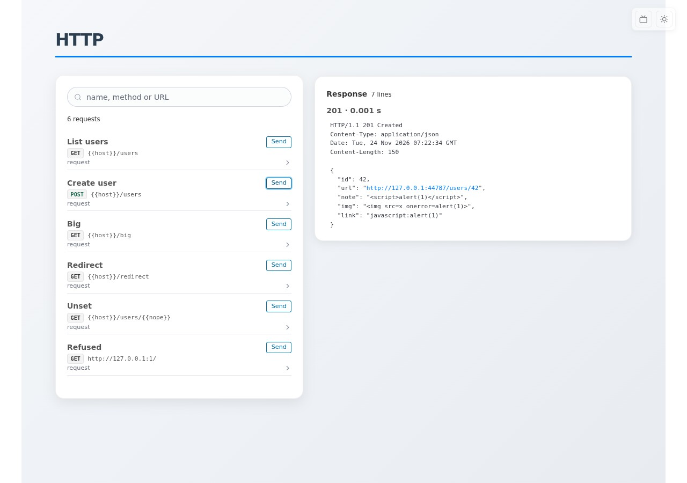
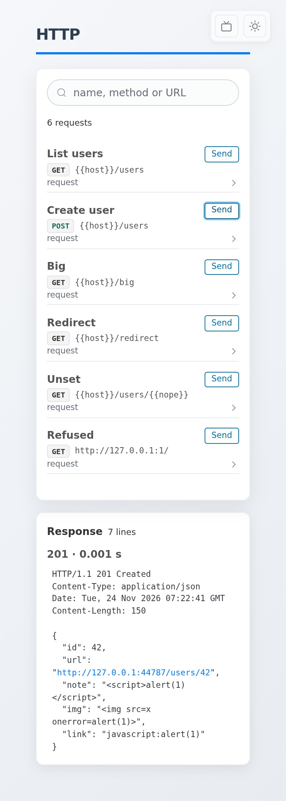

# HTTP

Lists the requests in your `.http` file, each with a Send button, and shows the response: status, headers, time, and the body, indented when it's JSON. Editing the file updates the list.



## Run it

The page holds no requests and runs no command of its own. You pass your `.http` file and the curl command that sends a request:

```sh
tinkerdown serve --allow-exec https://raw.githubusercontent.com/livetemplate/onefile/main/http/index.md \
  --source 'api=http:./api.http' \
  --source 'send=printf "%s" "$TD_headers" | curl -sS -i --max-time 30 -X "$TD_method" -H @- ${TD_body:+--data-binary "$TD_body"} -w "\n%{json}\n" -- "$TD_url"'
```

Then open http://localhost:8080. It needs tinkerdown 0.8.1 or later, and curl 7.75 or later.

| Flag | What it does |
|------|--------------|
| `--source api=http:./api.http` | Reads your `.http` file, one row per request, and reads it again when it changes. A relative path is taken from the directory you run `serve` in. |
| `--source send=…` | Sends the request you clicked with curl. It gets the request's method, URL, headers and body, with variables filled in, as `$TD_method`, `$TD_url`, `$TD_headers` and `$TD_body`. Headers go to curl on stdin, and a request without a body sends none. |

The same two sources can go in a config file of your own, so the curl command needs no shell quoting:

```yaml
# http.yaml
sources:
  api: {type: stream, http: ./api.http}
  send: {type: stream, cmd: 'printf "%s" "$TD_headers" | curl -sS -i --max-time 30 -X "$TD_method" -H @- ${TD_body:+--data-binary "$TD_body"} -w "\n%{json}\n" -- "$TD_url"'}
```

```sh
tinkerdown serve --allow-exec https://raw.githubusercontent.com/livetemplate/onefile/main/http/index.md --config http.yaml
```

A relative path in `http.yaml` is taken from that file's directory.

## Write the .http file

The file is the one the VS Code REST Client and JetBrains IDEs read, so the same file keeps working in your editor:

```http
@host = https://api.example.com
@token = {{$processEnv API_TOKEN}}

### List users
GET {{host}}/users
Accept: application/json

### Create user
POST {{host}}/users
Authorization: Bearer {{token}}
Content-Type: application/json

{"name": "Ada"}
```

- `###` separates requests, and the text after it names the next one.
- A request is its request line (`METHOD URL`, or a bare URL for `GET`), then headers up to the first blank line, then the body.
- `@name = value` defines a variable, and `{{name}}` uses it. `{{$processEnv NAME}}` reads the environment variable `NAME`, so a token can stay out of the file: `API_TOKEN=… tinkerdown serve …`.
- `#` and `//` start comments.

The file's environments (`http-client.env.json`), `< ./file` bodies and response scripts aren't read.

## Use it

| To | Do |
|----|----|
| Send a request | Press **Send** on its row. The pane beside the list shows "sending…", then the status line, the headers, the time, and the body. |
| Read a JSON response | A JSON body is indented, and its URLs are links. |
| See what a request sends | Open **request** under its row. It shows the headers and body as written, with `{{token}}` left as written. |
| Find a request | Search by name, method or URL. |
| Retry | Press **Send** again. A press while a request runs stops it and sends it again. |

Only a press on Send sends a request. Reloading the page, going Back or opening a shared link sends nothing, so a POST or DELETE never repeats by accident. A request that uses a variable set nowhere isn't sent, and the pane names the variable. A file that doesn't parse shows the line number, and the list keeps the last version that did.

curl doesn't follow redirects, so a request's `Authorization` header never goes to another host. Each request stops after 30 seconds (`--max-time 30`).

On a phone, the response sits below the list:



## What the page can show

The page never shows a variable's value: a token written as `{{token}}` stays `{{token}}` in the list. It does show:

- a header written out in the file, such as `Authorization: Bearer abc123`, instead of as a variable;
- anything a response returns, such as a `Set-Cookie` header or a token in a body.

On a shared machine, other users can see a request's URL and body in `ps` while curl runs, since curl gets them as arguments.

## Test

`TestHTTP` in [`../e2e`](../e2e) runs both commands above through `sh` against a local test server, and drives the page in Chrome:

```sh
cd ../e2e && go test -run TestHTTP ./...
```
