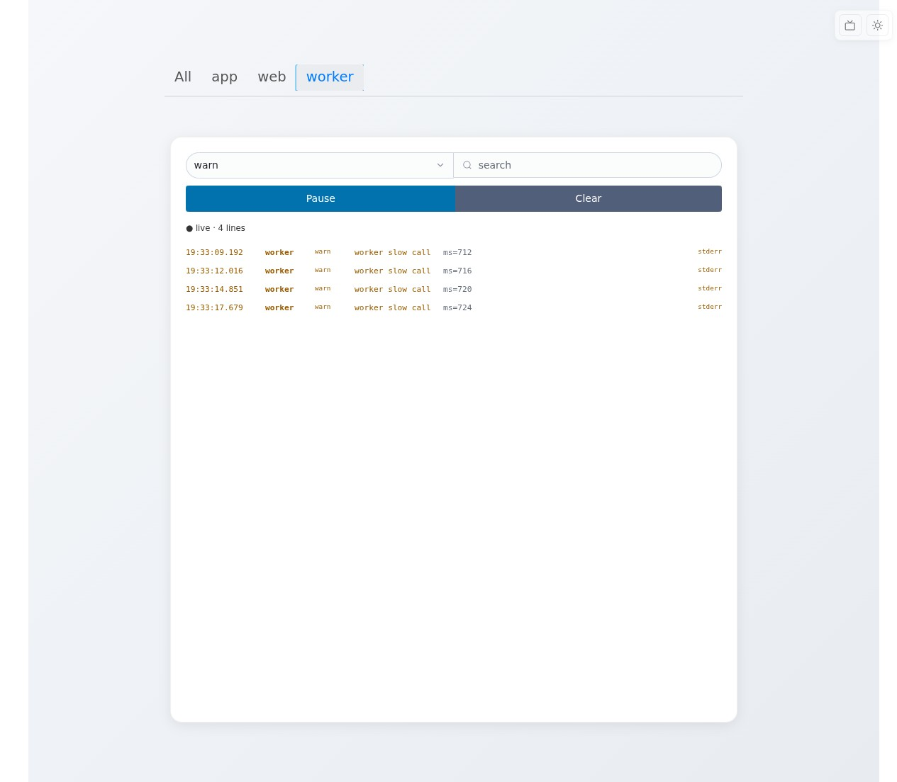
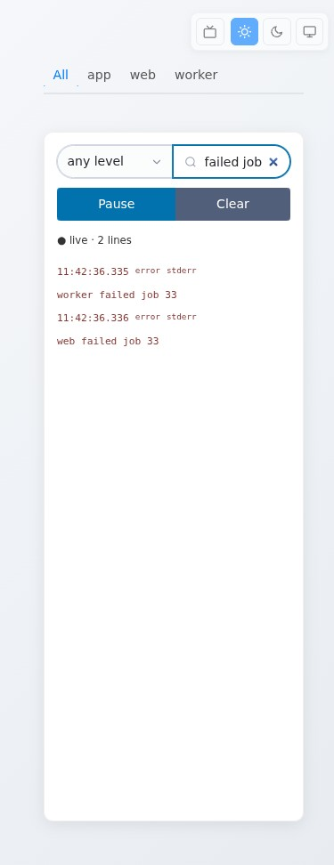

# Log Viewer

A live log viewer built with [tinkerdown](https://github.com/livetemplate/tinkerdown). It follows commands, docker containers and log files, and shows them in one timeline with a tab per source, level and text filters, pause, and clear.



## Run it

The page has no log sources of its own: you pass them when you serve it. Run it straight from GitHub, with a `--source` for each log and the last command after `--`:

```sh
tinkerdown serve --allow-exec github.com/livetemplate/onefile/logs \
  --source file:/var/log/app.log \
  -- docker logs -f --timestamps --tail 200 api
```

Then open http://localhost:8080. Each source gets a tab, here `api` and `app`, and **All** shows every source in one timeline. `serve` prints the page's SHA-256: add `#sha256=…` after the page's name to make sure you run the page you reviewed.

To run a local copy instead, use the file:

```sh
tinkerdown serve --allow-exec index.md -- docker logs -f api
```

Run it with no `--source` in a terminal and `serve` asks for sources, then prints the command to reuse. `--allow-exec` lets sources run commands; leave it out when every source is a `file:`.

Setting this up with a coding agent? Point it at [AGENTS.md](../AGENTS.md).

It needs tinkerdown 0.9.1 or later: `brew install livetemplate/tap/tinkerdown`.

## Add your own logs

Each `--source` adds one log, and so does the command after `--`. A value starting with `file:` follows that file; anything else is a command, run through the shell:

| To follow | Pass |
|-----------|------|
| A docker container | `--source 'docker logs -f --timestamps --tail 200 api'` |
| The systemd journal | `--source 'journal=journalctl -f -n 200 -o short-iso'` |
| A kubernetes deployment | `--source 'kubectl logs -f --timestamps --tail 200 deploy/api'` |
| A log file | `--source file:/var/log/syslog` |

A log's tab is named after its command's last word that isn't a flag, such as `api`, or its file's name, such as `syslog`. To pick the name, start the value with `NAME=`, as the journal row does, since its last word is `short-iso`. Names may use letters, digits, `_` and `-`. `tinkerdown serve --help` lists the options. All stream options are in [tinkerdown's stream source docs](https://github.com/livetemplate/tinkerdown/blob/main/docs/sources/stream.md).

### Follow a local web app

To see a web app's stdout and stderr, let the viewer start it. Pass its start command:

```sh
tinkerdown serve --allow-exec index.md \
  --source 'api=cd ../my-api && PORT=3000 go run ./cmd/server' \
  --source 'web=cd ../my-web && npm run dev'
```

The app starts when you first open the page, and stops 5 minutes after the last tab closes. Each line is tagged `stdout` or `stderr`, and stderr lines are marked in the list. If the app crashes, the viewer notes it and restarts it after 1 second, waiting longer after each crash, up to 30 seconds. Stopping `tinkerdown serve` stops the app and anything it started.

If the app already runs somewhere else, send its output to files and follow those instead. Start it with:

```sh
./server >out.log 2>err.log
```

Then pass each file:

```sh
tinkerdown serve index.md --source 'api-out=file:../my-api/out.log' --source 'api-err=file:../my-api/err.log'
```

## Use it

| To | Do |
|----|----|
| Watch everything | Stay on **All**. The list follows new lines. |
| Read back | Scroll up. The list stops following until you scroll back to the bottom. |
| Focus on one source | Pick its tab. |
| Find errors | Set the level to **error**. It keeps applying when you switch tabs. |
| Find text | Type in the search box. |
| Freeze the view | **Pause**. **Resume** catches up. |
| Start fresh | **Clear** hides the lines shown so far. |

A line in JSON or logfmt shows its message, then each other field as `key=value`. Any `http://` or `https://` URL in a line is a link that opens in a new tab.

Lines from stderr and the viewer's own notes (such as a restarted command) are marked at the right of each line.

On a phone, each line puts its time and level above the message:



## Test

The end-to-end test, `TestLogViewer` in [`../e2e`](../e2e), builds tinkerdown from source, serves a copy of this app with demo sources passed as `--source` flags, and drives it in Chrome. It needs Docker and Go:

```sh
cd ../e2e && go test -run TestLogViewer ./...
```

The demo inputs, two log-writing processes and a log file, live in `e2e/testdata/logs`, so the app itself is only `index.md`. See the [repo README](../README.md#test) for `TINKERDOWN_SRC` and `TINKERDOWN_BIN`.
