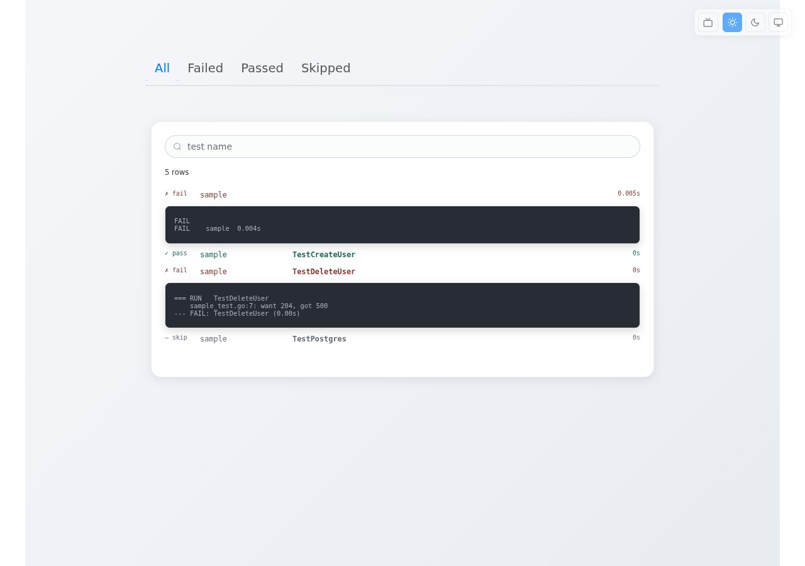
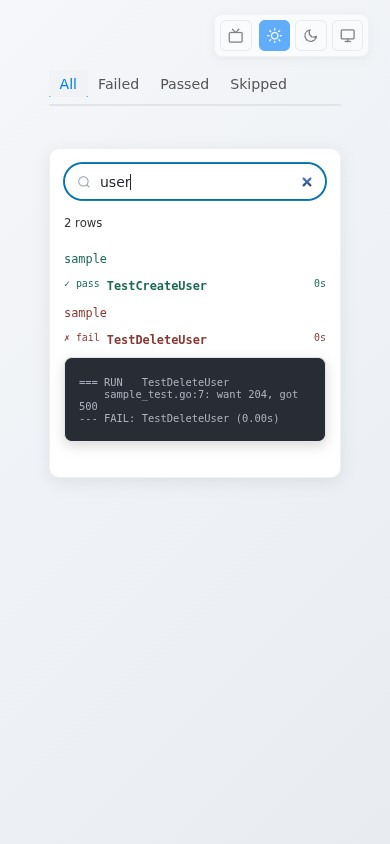

# Tests

Runs your tests on every save and shows one row per test: pass, fail, skip or running. Filter to failures, search by name, and read a failing test's output under its row.



## Run it

Pass a command that writes `go test -json`. With [watchexec](https://github.com/watchexec/watchexec), it reruns on every change:

```sh
tinkerdown serve --allow-exec https://raw.githubusercontent.com/livetemplate/onefile/main/tests/index.md \
  --source 'go=cd ~/code/myapp && watchexec -e go -- go test -json ./...'
```

Then open http://localhost:8080. Without watchexec, pass `go test -json ./...` on its own: when it exits, tinkerdown starts it again after a pause that grows to 30 seconds, so the page still catches up, only less often.

Each `--source` is one suite, so pass several to watch several modules: `--source 'api=cd api && …' --source 'web=cd web && …'`. It needs tinkerdown 0.6.0 or later.

## Use it

| To | Do |
|----|----|
| See what broke | Pick **Failed**. |
| Read why | A failing test shows its output under its row, from its latest run. |
| Find a test | Type part of its name in the search box. |

A test you delete keeps its last row until tinkerdown restarts.

On a phone, each row puts the package above the test:



## Test

`TestTests` in [`../e2e`](../e2e) serves this page from a URL with `go test -json` on a small sample module, and drives it in Chrome:

```sh
cd ../e2e && go test -run TestTests ./...
```
